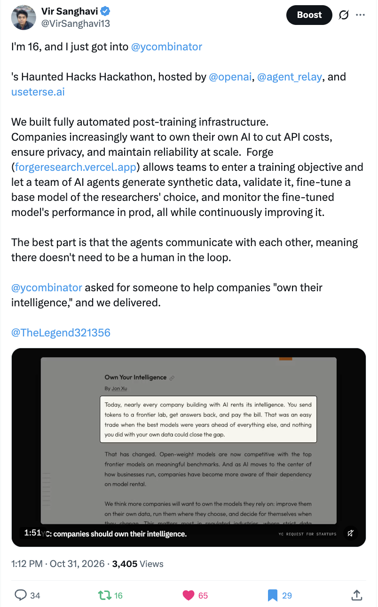

# Forge: Autonomous Post-Training Lab

Fresh commit history at the request of sponsors. The project was developed in a private repository, VirSanghavi/forge, whose history contained API keys and environment variables, so we squashed it into a fresh history for this public copy.



## Why Terse and Agent Relay are part of Forge

The local launcher starts Terse and the Agent Relay bridge before the API and interface. It also starts a local Relay engine unless you configure a hosted one. Campaigns use Terse for durable state, compute reservations and governance decisions. Relay carries messages between research roles. If delivery is not confirmed, downstream work pauses instead of acting on a missing handoff.

Terse defines seven actor types. Campaign flow uses `ResearchCampaignActor`, `ExperimentActor`, `GovernanceActor`, `ArtifactRegistryActor` and `RLWorldActor`; `TeamActor` supports team messaging and `HephaestusActor` stores the iMessage bot's memory and approvals. The lab's crash test kills Terse during a campaign, restarts it on the same data directory and checks that state is restored before interrupted work retries.

Forge coordinates research agents that diagnose a model's failures, propose and run post-training experiments, evaluate results, and select a checkpoint under independent governance and a bounded compute budget.

## Watch the demo

The hosted `/demo` is a read-only, captioned recording. The hosted `/lab` has no research engine attached, so campaigns cannot be started or queried there. The recording and a short explanation of the agent team, Agent Relay, and Terse are at <https://forgeresearch.vercel.app/demo>.

## Run the lab locally

You need Git and Node 24. Clone this public repository and start the lab:

```sh
git clone https://github.com/VirSanghavi/forgeresearch.git
cd forgeresearch
npm run lab
```

The first run installs the local dependencies and creates a private `.env` file. Setup can prompt for your own OpenAI API key; press Enter to skip it and use the local deterministic director. Cloud GPU training is optional and uses your own Modal account and billing. Nothing asks for or includes team credentials.

To register your own CSV or JSONL data:

```sh
npm run add-data -- ~/path/to/your-data.csv
```

The importer previews the columns and rows, then asks before it registers data for training. Run `npm run add-data -- --help` for options.

## What the recording shows

The film includes the 95-model picker, a Qwen campaign that moved from 1/24 to 10/24 on its sealed test, a production-failure run that fixed 8 of 33 held-out examples, and a run that rejected a candidate after it regressed. These are the recorded campaign results; they are not a general benchmark claim. The hosted site does not connect to the campaign engine.
